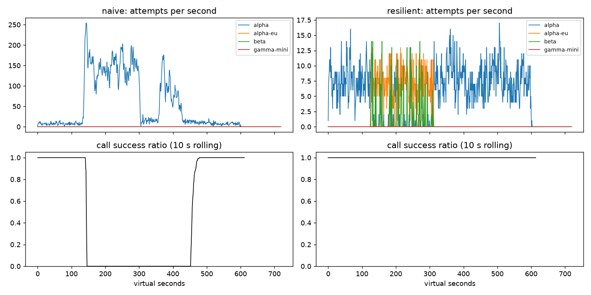

# Lab 25B — Report

**Họ tên / nhóm:** Mai Quang Dũng — **MSV:** 2A202602966  
**Commit:** 74f423651bc8cc962ada0f29be7252d2ff8d409c  
**Điểm tự động (`make grade`):** 84 / 88; 4 điểm SLO ẩn do giảng viên chấm. **Report:** chấm tay / 12.

Commit trên xác định phiên bản mã nguồn đã kiểm thử; báo cáo và các artifact được lưu trong commit tài liệu tiếp theo. Số liệu trong các bảng dùng seed 25. Kiểm tra thêm với seeds 25, 26, 27 đều PASS các băng public, workflow và cache; xem [scoreboard_multiseed.json](scoreboard_multiseed.json). Không có dữ liệu ẩn nên không tự nhận đủ 88 điểm hay bảo đảm kết quả trên băng ẩn.

Đã hoàn thành các file của Part A, B, C, D, E, G và chỉ tinh chỉnh khối `client:` / `cache:`. Giữ nguyên simulator, baseline, dịch vụ, bộ test và hai file băng sự cố theo quy tắc đề.

Lệnh tái lập từ thư mục repo, sau khi `pip install -e ".[dev,plot]"`:

```bash
python -m pytest -q
python scripts/run_gameday.py --client both
python scripts/run_workflows.py --executor both
python scripts/run_slo.py --alerter both
python scripts/run_gameday.py --scenarios configs/scenarios_cache.yaml --client resilient,cached --out reports/cache
python scripts/run_experiments.py --seed 25
python scripts/plot_timeseries.py --scenario G2_overload_storm
python scripts/grade.py
python scripts/grade.py --seeds 25,26,27 --out reports/scoreboard_multiseed.json
```

## 1. Kết quả Game Day (naive vs của bạn)

Nguồn: [gameday/naive.json](gameday/naive.json), [gameday/resilient.json](gameday/resilient.json). Availability là tỷ lệ lượt user thành công; p95 chỉ tính trên lượt thành công. Chi phí dùng đơn vị tương đối của simulator.

| Băng | Client | availability | p95 (s) | amplification | retry_ratio | cost/turn | recovery (s) | PASS? |
|---|---|---:|---:|---:|---:|---:|---:|:---:|
| G1 | naive | 0.7194 | 7.157 | 7.738 | 6.738 | 2.163 | 4 | FAIL |
| G1 | yours | 1.0000 | 4.732 | 1.061 | 0.003 | 2.099 | 0 | PASS |
| G2 | naive | 0.4560 | 15.034 | 9.904 | 8.904 | 4.627 | 155 | FAIL |
| G2 | yours | 1.0000 | 5.224 | 1.034 | 0.007 | 2.114 | 0 | PASS |
| G3 | naive | 1.0000 | 4.768 | 1.164 | 0.164 | 2.328 | 0 | FAIL |
| G3 | yours | 1.0000 | 4.642 | 1.035 | 0.019 | 2.101 | 0 | PASS |
| G4 | naive | 1.0000 | 13.764 | 1.004 | 0.004 | 2.008 | 0 | FAIL |
| G4 | yours | 0.9995 | 5.419 | 1.036 | 0.007 | 2.124 | 0 | PASS |
| G5 | naive | 0.3699 | 5.359 | 17.030 | 16.030 | 2.124 | — | FAIL |
| G5 | yours | 0.8175 | 5.484 | 1.009 | 0.007 | 2.513 | — | PASS |
| G6 | naive | 0.5170 | 4.836 | 12.344 | 11.344 | 2.009 | 0 | FAIL |
| G6 | yours | 1.0000 | 6.081 | 1.061 | 0.024 | 2.207 | 0 | PASS |

G1 có 0 vi phạm `retry-after`; G5 có 0 retry trên lỗi client và 0 failover không cần thiết; G6 có 0 route không tương thích. Tỷ lệ traffic về primary sau khôi phục là G1: 0.922; G2, G3, G4, G6: 1.000. G5 không định nghĩa `restore_at`, nên recovery không áp dụng. `recovery_s = 0` đo cửa sổ 30 giây có ít nhất 95% logical call thành công kể từ provider restore; fallback có thể duy trì chỉ số này ngay cả trước khi primary đóng breaker.

## 2. Cấu hình client và lý do

| Tham số | Giá trị | Vì sao (dựa trên băng nào, số liệu nào) |
|---|---:|---|
| attempt_timeout_s | 4.0 | Chừa thời gian fallback trong deadline 30 s. Trên G2, thử ban đầu 8 s cho p95 11.874 s; 4 s giảm xuống 5.224 s và vẫn availability 1.0000. G6 timeout 30 s làm availability còn 0.9488. |
| max_attempts_per_provider | 2 | Một lần đầu và tối đa một retry, sau đó fallback. G3 retry_ratio 0.019; thử 5 attempt khi breaker bị vô hiệu hóa và budget bị tắt tăng lên 0.160. |
| min_time_left_s | 1.0 | Không cấp attempt nếu còn dưới 1 s; timeout luôn được cắt theo deadline. Test deadline PASS; ở thí nghiệm G6 timeout 30 s có 122 lần GiveUp deadline. |
| backoff_base_s / cap_s | 0.25 / 4.0 | Full jitter làm các lần retry phân tán; `retry-after` được cộng jitter 0–0.25 s. G1 có 0 vi phạm header và amplification 1.061. |
| retry_budget_ratio | 0.10 | Chặn retry cùng provider khi lỗi kéo dài. Khi breaker cấu hình sai, G3 retry_ratio 0.068 với budget so với 0.160 khi tắt budget. |
| retry_budget_min_per_s / max_tokens | 0.5 / 20 | Bucket có dự trữ ban đầu và hồi tối thiểu để retry được khi ít traffic. Budget là giới hạn dài hạn, không phải bảo đảm tuyệt đối 10% ở mọi cửa sổ ngắn vì còn token ban đầu và hồi theo thời gian. G3 thực tế đạt 0.019. |
| quota_cooldown_s | 300 | Quota không hồi nhờ retry. Cách ly từng deployment A sau lỗi quota; G5 đạt availability 0.8175, 0 retry client error và 0 failover không cần thiết. |
| breaker.window_size / min_calls | 20 / 10 | Bỏ kết quả quá cũ và chờ đủ mẫu trước khi trip. G2 amplification 1.034 so với naive 9.904; G5 không trip do lỗi 400. |
| breaker.failure_rate_threshold | 0.5 | Trip khi ít nhất nửa cửa sổ là lỗi sức khỏe provider. G2 và G6 vẫn availability 1.0000; G3 đạt retry_ratio 0.019 nhờ cả breaker và budget. |
| breaker.slow_call_s / slow_rate_threshold | 5.0 / 0.6 | Cài đặt xử lý cả thành công chậm; ở thí nghiệm timeout 30 s, G4 vẫn có p95 5.608 s nhờ slow-call breaker. Với cấu hình timeout 4 s, call chậm thường timeout trước ngưỡng này và đi nhánh failure. |
| breaker.open_duration_s | 10.0 | Thử lại định kỳ để primary có cơ hội hồi phục. G2 recovery 0 s theo SLI người dùng và primary_share_after_restore 1.000; thời gian OPEN không tăng theo số lỗi. |
| breaker.half_open_max_probes / half_open_successes | 2 / 2 | Chỉ hai probe đang bay; hai thành công nhanh mới đóng breaker. Các test concurrency/generation PASS; G2 quay lại primary mà amplification chỉ 1.034. |

Quyết định `on_error`:

| Loại lỗi | Ghi breaker? | Retry cùng provider? | Failover? | Cooldown |
|---|---|---|---|---|
| CLIENT_ERROR (400, 401, 403, …) | release permit, không ghi health | Không | Không; GiveUp client_error | Không |
| QUOTA_EXHAUSTED (429 insufficient_quota) | release permit | Không | Ngay | 300 s theo deployment |
| RATE_LIMITED (429 khác) | release permit | Chỉ chờ nếu hết lựa chọn, có budget và còn deadline | Ngay trước khi phải chờ | Ít nhất retry-after; chia sẻ giữa các call |
| OVERLOADED (503/529) | on_failure | Nếu còn attempt, breaker CLOSED, budget và deadline cho phép; full jitter | Khi không retry được | Breaker quyết định |
| SERVER_ERROR (5xx khác) | on_failure | Như trên | Như trên | Breaker quyết định |
| TIMEOUT (0/408) | on_failure | Như trên | Như trên | Breaker quyết định |

Ladder tool: `alpha → alpha-eu → beta`; ladder chat thêm `gamma-mini`. Mỗi call bắt đầu lại từ primary. Khi không có lựa chọn dùng được, chỉ cân nhắc cooldown rate limit ngắn ≤ 5 s; không đợi quota và không bỏ qua retry budget khi đã từng gọi deployment đó. Permit được release khi hủy attempt; kết quả khác generation bị bỏ qua. Công thức jitter bám theo [AWS: Exponential Backoff And Jitter](https://aws.amazon.com/blogs/architecture/exponential-backoff-and-jitter/).

## 3. Ba thí nghiệm

Nguồn cho toàn bộ thí nghiệm: [experiments.json](experiments.json); script [run_experiments.py](../scripts/run_experiments.py) thay cấu hình trong bộ nhớ, không thay file nộp bài.

**1. Retry budget là lớp phòng thủ cuối.** Cả hai biến thể đặt `breaker.min_calls = 1000000000`, `max_attempts_per_provider = 5`. Biến thể tắt budget đặt ratio 100, max_tokens 1e9, min_per_s 1e6 theo đề.

| Băng | Budget | availability | amplification | retry_ratio | recovery (s) | p95 (s) |
|---|---|---:|---:|---:|---:|---:|
| G2 | Giữ | 0.9996 | 1.424 | 0.062 | 0 | 11.911 |
| G2 | Tắt | 0.9822 | 1.800 | 0.509 | 0 | 18.868 |
| G3 | Giữ | 1.0000 | 1.136 | 0.068 | 0 | 4.568 |
| G3 | Tắt | 1.0000 | 1.163 | 0.160 | 0 | 4.809 |

Khi breaker không trip, budget ngăn call lỗi tự tạo thêm tải: G2 có 1 lần GiveUp khi giữ budget, so với 42 deadline khi tắt. Recovery vẫn 0 ở cả hai vì fallback còn phục vụ được; sự khác biệt nằm ở retry, amplification và latency. Khi breaker hoạt động đúng, cấu hình nộp đạt G2 amplification 1.034, G3 retry_ratio 0.019, nên budget thường ít phải can thiệp hơn. Vẫn cần cả hai vì breaker cần thời gian gom đủ mẫu và có thể bị cấu hình sai, còn budget không đánh giá được sức khỏe để cách ly provider.

**2. Timeout 30 giây.**

| Băng | Timeout | availability | p95 (s) | GiveUp |
|---|---:|---:|---:|---|
| G6 | 4 s | 1.0000 | 6.081 | Không |
| G6 | 30 s | 0.9488 | 5.481 | deadline: 122 |
| G4 | 4 s | 0.9995 | 5.419 | no_provider_available: 1 |
| G4 | 30 s | 1.0000 | 5.608 | Không |

Ở G6, deployment treo dùng hết deadline nên không còn thời gian fallback; p95 giảm vì loại khỏi mẫu những lượt thất bại sau khi chờ lâu, không phải vì trải nghiệm tốt hơn. G4 gần như không đổi về availability và p95 vì provider vẫn trả lời trong khoảng vài giây, rồi slow-call breaker chuyển tải sang deployment khác. Timeout cần dựa vào latency bình thường của từng deployment, deadline cả lượt và thời gian dành cho fallback, không lấy toàn bộ 30 s làm timeout của một attempt. Cấu hình 4 s là giá trị đã kiểm chứng trên các băng này; không khẳng định phù hợp mọi workload thực tế.

**3. Bỏ lọc tool calling khỏi ladder.**

| G6 | availability | incompatible_routes | GiveUp |
|---|---:|---:|---|
| Có lọc | 1.0000 | 0 | Không |
| Bỏ lọc | 0.8893 | 264 | incompatible_model_output: 264 |

Khi A sập và B bị giới hạn, 264 call cần chọn tool bị chuyển sang model không hỗ trợ chức năng đó. Với product manager, đây là 264 lượt mà hệ thống có thể tạo văn bản nhưng không thực hiện được bước cần thiết để hoàn tất yêu cầu khách hàng. Nhà cung cấp rẻ và còn hoạt động vẫn không phải lựa chọn hợp lệ nếu thiếu năng lực của bước workflow. Lọc capability bảo vệ tính đúng của kết quả trước khi cân nhắc availability hay chi phí.

## 4. Workflow hoàn tiền

Nguồn: [workflows.json](workflows.json), 500 session, seed 25.

| Executor | completion | crashes | duplicate refunds | duplicate emails | lost refunds | overpaid (cents) | wasted LLM / crash |
|---|---:|---:|---:|---:|---:|---:|---:|
| naive | 1.0000 | 81 | 128 | 81 | 0 | 1496700 | 1.123 |
| yours | 1.0000 | 66 | 0 | 0 | 0 | 0 | 0.303 |

Executor mới có đúng 500 payment execution và 2500 checkpoint write, tức 5 bước mỗi session. Key idempotency là SHA-256 của cặp `[session_id, step]` có namespace; mọi retry/restart của cùng side effect dùng cùng key, các bước và session khác dùng key khác. Thứ tự là đọc checkpoint → nếu chưa có thì chạy step với retry hữu hạn → ghi kết quả sau thành công → bước tiếp theo. Chỉ bắt `ServiceError` và `ServiceTimeout`; `WorkerCrash` thoát ra runner để khởi động worker mới.

Chỉ idempotency key chưa đủ để tiết kiệm việc đã làm: classify/lookup/summary có thể chạy lại và tốn LLM dù payment/email không trùng. Chỉ checkpoint chưa đủ vì worker có thể chết sau khi tiền đã chuyển nhưng trước lúc ghi checkpoint; lần resume sẽ gọi payment lại. Kết hợp hai cơ chế bảo vệ khoảng trống này và tránh làm lại các bước đã được lưu; semantics retry cùng key tương ứng mô hình [Stripe: Idempotent requests](https://docs.stripe.com/api/idempotent_requests). Nếu ghi checkpoint trước payment rồi worker chết, resume sẽ bỏ qua một giao dịch chưa từng thực hiện, gây mất hoàn tiền.

## 5. Alerting & error budget

Nguồn: [slo.json](slo.json), `data/sli_30d.csv`, `data/sli_30d_labels.json`. Độ trễ ở hai cột cuối tính bằng phút từ lúc sự cố bắt đầu.

| Sự cố | Mong đợi | Naive alerter | Burn-rate alerter | Độ trễ naive | Độ trễ burn-rate |
|---|---|---|---|---:|---:|
| checkout_bug | page | page | page | 1 | 27 |
| provider_outage | page | page | page | 0 | 4 |
| deploy_blip | none | page sai | Không page | — | — |
| slow_leak | ticket | Bỏ sót | ticket, không page | — | 1337 |
| degraded_evening | page | page | page | 214 | 291 |
| night_spike | none | page sai | Không page | — | — |
| small_bump | none | page sai | Không page | — | — |

Naive tạo 7 episode page, 0 ticket, 3 false page. Burn-rate tạo đúng 3 episode page, 1 ticket và 0 false page; mọi sự cố cần phát hiện đều nằm trong thời hạn nhãn. Dùng prefix sum nên mỗi phép tính cửa sổ là O(1), evaluate là O(N × số rule), không cộng lại hàng nghìn phút cho mỗi truy vấn.

`burn = (bad_window / total_window) / 0.005`. Một rule chỉ fire khi **cả hai** cửa sổ đạt ngưỡng: page 14.4× với 60 & 5 phút; page 6× với 360 & 30 phút; ticket 1× với 4320 & 360 phút. Episode bắt đầu ở phút đầu fire, kết thúc exclusive tại phút đầu không fire. Các cửa sổ và ngưỡng theo [Google SRE Workbook, Alerting on SLOs](https://sre.google/workbook/alerting-on-slos/).

Error budget 30 ngày:

```text
requests           = 25,901,755
allowed_bad        = 25,901,755 × 0.005 = 129,508.8 (làm tròn 1 chữ số)
bad                = 55,618
availability       = 0.997853
budget_consumed    = 0.4295 = 42.95%
budget_remaining   = 0.5705 = 57.05%
freeze_releases    = False
```

Không đóng băng release vì còn budget. `small_bump` có 1794 lỗi trên 15211 request trong 20 phút, chỉ tiêu khoảng 1.385% budget tháng; ở cuối sự cố, tỷ lệ lỗi cửa sổ 1 h là 4.113%, thấp hơn ngưỡng fast page 7.2% (=14.4 × 0.5%). Cửa sổ 6 h cũng không đủ để đạt ngưỡng slow page. Do đó lỗi ngắn tự hết này không nên đánh thức on-call chỉ vì tỷ lệ lỗi 5 phút cao; có thể theo dõi và xử lý trong giờ làm việc.

## 6. Postmortem — Băng G2 với client naive (blameless)



**Tóm tắt:** Tại t=120 s, alpha mất 75% năng lực trong 180 s. Retry ở ba tầng đã khuếch đại tải thành 34475 attempt cho 3481 logical call, khiến 1285/2362 lượt user thất bại. Provider hồi phục ở t=300 s, nhưng hệ thống chỉ đạt tiêu chí recovery tại cửa sổ bắt đầu t=455 s, thêm 155 s.

**Ảnh hưởng:** 54.403% lượt user của replay thất bại; chỉ 1077 lượt thành công, p95 của lượt thành công 15.034 s. Từ t=150 đến trước t=300 có 0/631 logical call hoàn tất thành công; từ t=300 đến trước t=455 chỉ 8/554. Khoảng từ trigger đến cửa sổ recovery dài 335 s (180 s suy giảm provider + 155 s kéo dài sau restore); đây là khoảng suy giảm, không khẳng định mọi giây trong đó đều có 0% thành công.

Giả sử tháng chỉ có sự cố này và traffic trung bình 4 lượt/s suốt 30 ngày, tháng có 10368000 lượt và budget 99.5% cho phép 51840 lượt lỗi. 1285 lượt lỗi tiêu **2.479% budget tháng**, không vượt tổng budget tháng; availability tháng theo giả định là 99.987606%. Nếu chuẩn hóa riêng mẫu replay 2362 lượt thì budget chỉ 11.81 lượt lỗi, nên sự cố tiêu 108.806 lần budget của mẫu. Hai mẫu số khác nhau; không dùng mức lỗi 54.403% của 10 phút để suy ra tháng mất 54.403% availability.

**Timeline:** số attempt lấy trực tiếp từ [gameday/naive_G2_overload_storm_timeseries.csv](gameday/naive_G2_overload_storm_timeseries.csv). Success ratio là `sum(calls_ok)/sum(calls_done)` trong 10 giây kết thúc tại t, cùng cách tính trong script plot; call khác lượt user.

| t (s) | Sự kiện | attempts alpha / s | calls_ok / calls_done (10 s) | Success ratio |
|---:|---|---:|---:|---:|
| 119 | Bình thường trước sự cố | 9 | 92 / 92 | 1.000 |
| 120 | Alpha mất 75% năng lực; các call cũ còn hoàn tất | 5 | 90 / 90 | 1.000 |
| 144 | Đỉnh attempt rate trong replay | 254 | — | — |
| 150 | Retry storm, hệ thống không trả được call thành công | 163 | 0 / 50 | 0.000 |
| 240 | Vòng lặp retry tiếp tục | 105 | 0 / 56 | 0.000 |
| 300 | Provider đã hồi phục, client vẫn thất bại | 115 | 0 / 43 | 0.000 |
| 360 | Queue và retry chưa thoát vòng lặp | 50 | 0 / 36 | 0.000 |
| 420 | Vẫn chưa có thành công trong cửa sổ 10 s | 53 | 0 / 36 | 0.000 |
| 455 | Cửa sổ 30 s bắt đầu đạt tiêu chí recovery; cửa sổ 10 s còn pha trộn lỗi cũ | 13 | 12 / 40 | 0.300 |
| 480 | Hệ thống trở lại trạng thái phục vụ ổn định | 8 | 137 / 137 | 1.000 |

**Trigger vs root cause:** trigger là mất năng lực GPU của alpha. Root cause phía client là retry chồng app × gateway × SDK, tối đa 36 attempt/call, delay cố định, không phân loại lỗi, không jitter, không budget, không breaker và không fallback. Client timeout không hủy công việc đã vào queue; retry bổ sung lại phải xếp hàng sau công việc mà user không còn đợi. Queue kéo dài → timeout/529 → retry → queue tiếp tục đầy; rate limit tạo thêm lỗi và naive retry cả lỗi đó trước `retry-after`. Đây là vòng lặp metastable khiến khôi phục GPU tại t=300 không đủ để khôi phục dịch vụ ngay.

Trong 0–120 s, alpha nhận trung bình 7.542 attempt/s. Ở 150–300 s, tải tăng tới 146.527 attempt/s, trong khi 0/631 call thành công; sau restore, ở 300–455 s vẫn trung bình 49.194 attempt/s. Toàn băng có 2737 timeout, 3194 overloaded error, 26298 rate-limit error và 28381 vi phạm retry-after. Số liệu cho thấy hệ thống tự giữ tải cao sau khi nguyên nhân ban đầu đã kết thúc; không quy lỗi cho cá nhân triển khai hay on-call.

**Điều gì giúp / làm tệ hơn:** timestamp ảo, CSV và băng lặp được giúp phân biệt nguyên nhân provider với phản ứng client. Giới hạn attempts/deadline và server shedding là chốt cuối giúp replay không chạy vô hạn, nhưng không đủ để duy trì availability. Retry đồng bộ, chồng tầng và không hủy công việc provider làm tệ hơn. Cấu hình mới đưa G2 về 100% availability, amplification 1.034 và cost/turn 2.114 thay cho 4.627.

| # | Hành động | Loại | Owner (vai trò) | Cách kiểm chứng |
|---|---|---|---|---|
| 1 | Dùng đúng một tầng retry; phân loại lỗi, jitter và retry budget | prevent | Chủ sở hữu client ShopAgent | G2 amplification ≤ 1.6; G3 retry_ratio ≤ 0.10; G1 vi phạm retry-after = 0 trên seeds 25/26/27 |
| 2 | Theo dõi amplification, provider errors, timeout, trạng thái breaker và SLO burn-rate | detect | SRE/on-call | SLO public: đủ page/ticket đúng thời hạn, 0 false page; G2 dashboard phát hiện tải 146.527 attempt/s và call success 0% |
| 3 | Bật sliding-window breaker, giới hạn probe và fallback có capability | mitigate | Nhóm reliability | G2 availability ≥ 95%, recovery ≤ 30 s, primary share ≥ 80%; G6 incompatible_routes = 0 |
| 4 | Giới hạn timeout từng attempt, chừa deadline cho fallback | prevent | Chủ sở hữu workflow | G6 cấu hình 4 s đạt availability 1.0000 so với 0.9488 ở 30 s; test deadline PASS |

## 7. Một điểm yếu còn lại

Khi tất cả provider đều sập, cache chỉ cứu được FAQ chung; không thể thực hiện tool hay trả lời trạng thái tài khoản cá nhân. C1 dù có cache vẫn có availability toàn bộ 0.9124 trong khi FAQ availability 0.9645; 246 logical call GiveUp `no_provider_available`. Stale cũng có thể sai với một cập nhật không được thông báo: TTL 30 s vẫn tạo 2 `outdated_answers`. Nếu triển khai thực tế, hướng xử lý là hàng đợi/resume cho tác vụ cần tool và kiểm tra phiên bản nguồn với hệ thống nội dung; đây là đề xuất cải thiện, không cài thêm ngoài phạm vi lab.

## 8. Cache (Part G)

Nguồn: [cache/resilient.json](cache/resilient.json), [cache/cached.json](cache/cached.json), [experiments.json](experiments.json).

| Client | availability | faq_availability | cache_hit_ratio | stale_served | wrong_answers | outdated_answers | cost/turn | PASS? |
|---|---:|---:|---:|---:|---:|---:|---:|:---:|
| resilient (không cache) | 0.8373 | 0.8424 | 0.000 | 0 | 0 | 0 | 1.386 | FAIL |
| cached (của bạn) | 0.9124 | 0.9645 | 0.592 | 192 | 0 | 2 | 0.955 | PASS |

FAQ availability tăng 12.21 điểm phần trăm; cost/good turn giảm khoảng 31.1%. `wrong_answers_by_reason = {}` ở cấu hình nộp bài. Câu hỏi personal bị loại cả khi lookup và store; scope theo prompt_version; hit chọn cosine lớn nhất; LRU giới hạn kích thước. Hit tươi trả ngay, hết TTL thì vẫn hỏi provider; chỉ dùng stale khi inner client GiveUp, và lookup lại ở thời điểm đó để tôn trọng webhook có thể đến trong lúc call đang chạy. Stale-if-error có cơ chế tương tự [RFC 5861](https://www.rfc-editor.org/rfc/rfc5861), với thời gian cho phép cũ được giới hạn rõ ràng.

| Tham số cache | Giá trị | Vì sao |
|---|---:|---|
| similarity_threshold | 0.90 | 0 câu sai và hit 0.592; 0.80 gây 181 câu sai; 0.97 chỉ hit 0.499, dưới yêu cầu 0.50. |
| ttl_s | 30 | Chỉ 2 câu lỗi thời, thay cho 3 ở TTL 60 và 95 ở TTL 300; chọn biên an toàn hơn cho thay đổi không báo. |
| max_stale_s | 300 | Giữ câu đã quá TTL qua outage 120 s; phục vụ 192 stale, FAQ availability 0.9645. Tắt stale làm FAQ availability còn 0.8529. |
| max_entries | 500 | Giới hạn LRU theo đề; đủ cho FAQ/scope trong C1, đạt hit 0.592 mà không cache dữ liệu cá nhân. |

**1. Ngưỡng.**

| similarity_threshold | hit ratio | wrong_answers | wrong_answers_by_reason | cost/turn |
|---:|---:|---:|---|---:|
| 0.80 | 0.610 | 181 | other_question: 181 | 1.016 |
| 0.90 | 0.592 | 0 | {} | 0.955 |
| 0.97 | 0.499 | 0 | {} | 1.018 |

Ngưỡng lỏng gộp các câu gần nhau về embedding nhưng cần câu trả lời khác: chính sách hoàn tiền/thời gian tiền về; đổi size/đổi màu; phí ship nội thành/ngoại tỉnh; phương thức thanh toán/COD. Đây là các cặp near-miss trong catalog của đề; metric chỉ xác định 181 lỗi `other_question`, không cung cấp số lỗi riêng cho từng cặp. 0.90 tách được các intent mà vẫn dùng chung câu trả lời cho nhiều diễn đạt. 0.97 quá chặt khiến một số paraphrase phải gọi provider, hit thấp hơn mức cần đạt.

**2. TTL.**

| ttl_s | hit ratio | outdated_answers | faq_availability | cost/turn |
|---:|---:|---:|---:|---:|
| 30 | 0.592 | 2 | 0.9645 | 0.955 |
| 60 | 0.652 | 3 | 0.9645 | 0.915 |
| 300 | 0.731 | 95 | 0.9640 | 0.863 |

Webhook giúp xóa ngay câu trả lời dựa trên chính sách hoàn tiền đổi tại t=150; scope v2 cũng không dùng câu prompt v1. Bảng phí ship đổi tại t=480 không có webhook, nên invalidate không có tín hiệu để chạy; khi provider còn khỏe, TTL buộc lấy lại đáp án và giới hạn độ cũ. TTL 300 tiết kiệm thêm chi phí nhưng vi phạm `outdated_answers ≤ 15`; TTL 30 đạt yêu cầu. Nếu provider đồng thời sập lúc nguồn thay đổi âm thầm, stale có thể kéo dài độ cũ thêm max_stale_s; lab chấp nhận đánh đổi này trong cửa sổ cho phép.

**3. Stale-if-error.**

| max_stale_s | faq_availability | hit ratio | stale_served | wrong_answers | outdated_answers |
|---:|---:|---:|---:|---:|---:|
| 300 | 0.9645 | 0.592 | 192 | 0 | 2 |
| 0 | 0.8529 | 0.481 | 0 | 0 | 2 |

Không stale thì entry hết TTL trong outage không thể thay provider, FAQ availability giảm 11.16 điểm phần trăm và hit thấp hơn 50%. Stale vẫn phải cùng scope, đúng intent, không personal và chưa bị invalidation; không tạo lại câu trả lời giả hay kéo dài stored_at mỗi lần đọc. Phải lookup lại sau GiveUp để không trả một entry đã bị xóa trong lúc chờ provider.

**Vì sao không cache câu hỏi cá nhân, kể cả theo user?** Trạng thái đơn hàng, hoàn tiền và điểm thay đổi theo giao dịch, không ổn định như FAQ; user scope chỉ giải quyết lộ dữ liệu giữa người dùng, không bảo đảm dữ liệu hiện tại. Bản thân câu hỏi của hai đơn khác nhau có embedding rất gần, nên semantic hit cũng dễ trả trạng thái sai ngay trong cùng tài khoản. Theo allowlist của lab, tất cả request.personal đều bypass cache; chỉ FAQ chung đủ điều kiện lưu.

**Alert khi dashboard xanh nhờ stale:** Theo dõi song song SLI trả lời user và sức khỏe provider: tỷ lệ lỗi/timeout của attempt thực sự gửi, breaker OPEN/HALF_OPEN, số GiveUp trước khi chuyển sang Serve, stale_served và tỷ lệ phục vụ stale. C1 có 192 stale trong khi mọi provider sập; số đó phải hiện riêng thay vì gộp vào thành công provider. Dùng probe hoặc SLI provider có mẫu traffic thực, không suy ra sức khỏe upstream từ cache hit. Đặt cảnh báo stale kéo dài/gần hết max_stale_s để biết nguy cơ mất khả năng phục vụ sau cửa sổ stale; đây là câu trả lời thiết kế alert theo yêu cầu report, không thêm hệ thống monitoring ngoài lab.
